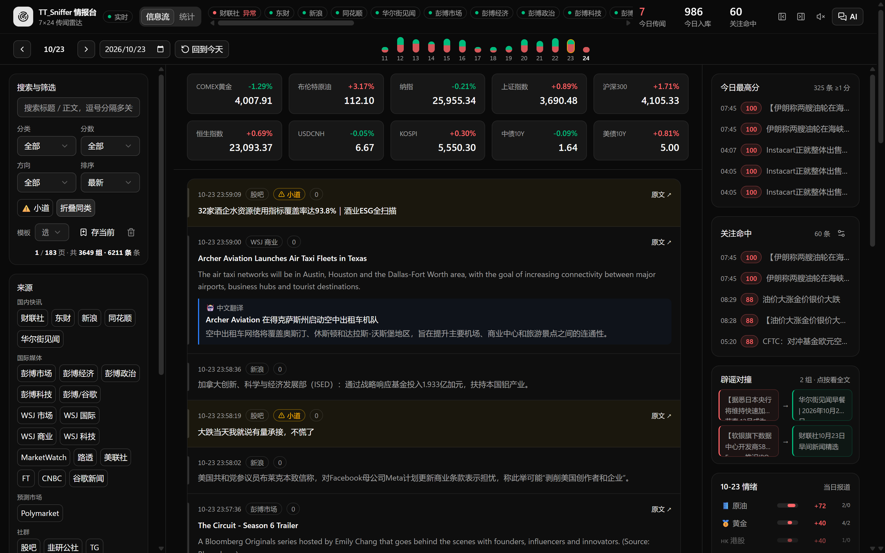
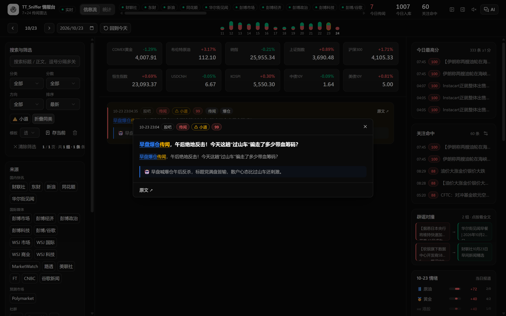
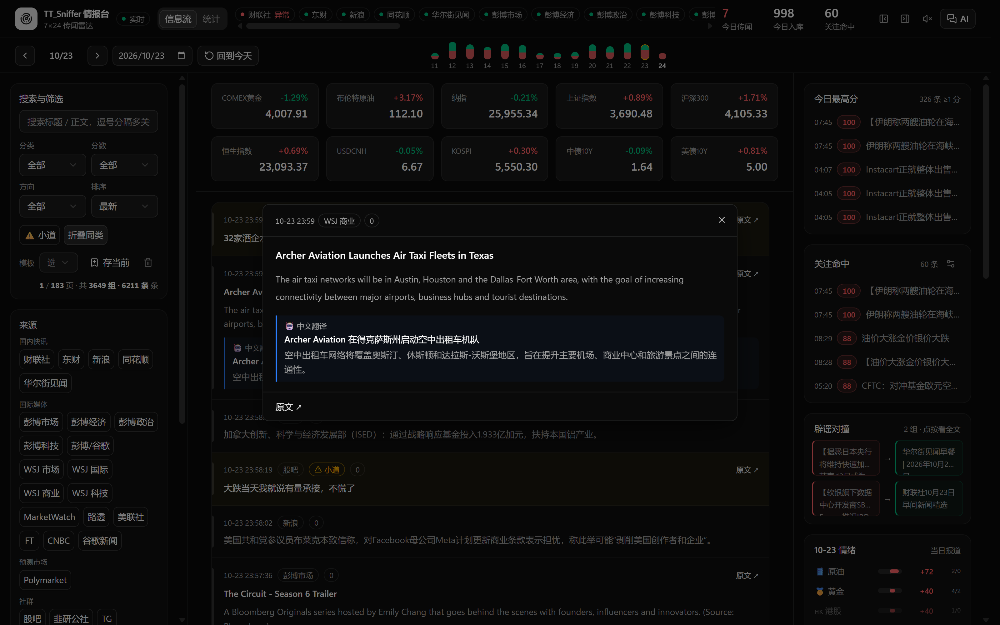
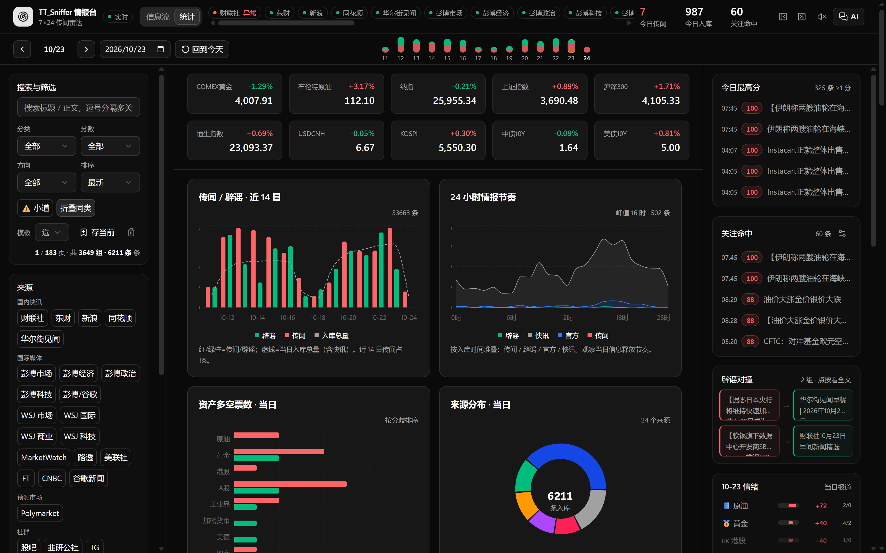
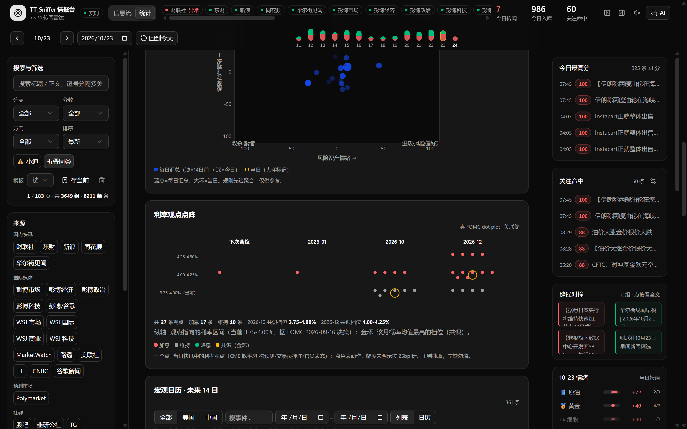
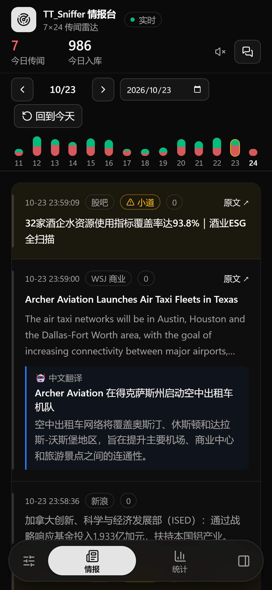
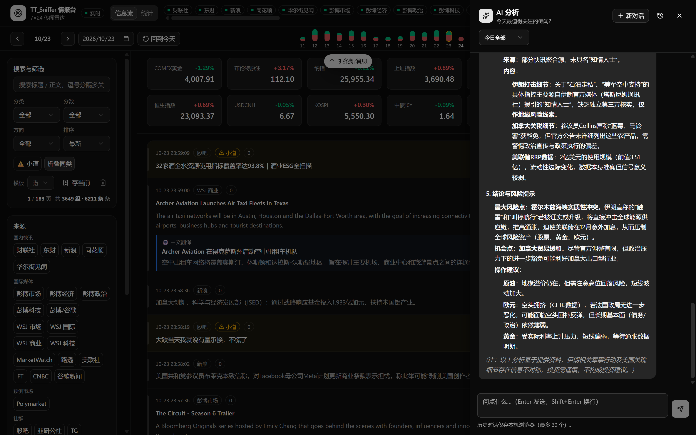
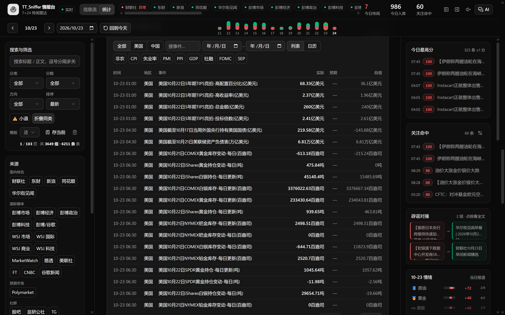

# TT_Sniffer · 7×24 Rumor Intelligence Desk (情报台)

[English](README.md) · [简体中文](README_zh.md)

**TT_Sniffer is a self-hosted intelligence desk that watches the public secondary
propagation layer of Chinese market rumors — the "小作文" (lit. "little essays":
unverified market narratives that are first fabricated in private group chats,
then leak to public platforms within minutes) — so you learn about a rumor in
minutes, not days.**

It aggregates 20+ public sources into one local, real-time window, classifies
each item with a rule engine (and optionally an LLM), scores and clusters them,
plots sentiment and rate expectations, and pushes alerts — all in a single
FastAPI + SQLite process with a prebuilt React frontend.

<p align="center">
  
</p>

## Why

Market-moving rumors in China follow a predictable path: fabricated in WeChat
groups → screenshotted → leaked to 股吧 (guba), 韭研公社, WeChat public accounts,
Telegram channels → amplified by financial media. By the time official
fast-news wires carry it, the price has moved. TT_Sniffer continuously sniffs
the **public leak points** (it deliberately does not and will not touch private
chats — see [Compliance](#compliance--boundaries)), cross-checks them against
official wires and debunk statements, and surfaces what matters.

## What you get

**Collection — 20+ sources, one pipeline**

| Layer | Sources | Notes |
|---|---|---|
| CN fast wires | 财联社 cls / 东财 em / 新浪 7x24 / 同花顺 / 华尔街见闻 | 30–60s polling, line-level fault tolerance |
| Global media RSS | Bloomberg ×5, WSJ ×4, MarketWatch, FT, CNBC, Reuters & AP via Google News | titles + summaries only, never bypasses paywalls |
| Street layer ⚠️ | 股吧 (guba) hot posts **with full-text detail enrichment**, 韭研公社 (SSR payload parsing + full-text fetch), Telegram public channels, crypto media RSS | `tier=street` — flagged unverified, never triggers intrusive alerts |
| Prediction markets | Polymarket (Gamma + CLOB + Data API) | emits a signal only when implied probability moves ≥ 5 pp |
| Market microstructure | 盘口异动 (intraday order-flow anomalies) + 涨停池 limit-up pool | fuels the rumor ↔ price-action linkage bonus |
| Macro | calendar (nonfarm/CPI/FOMC/SEP…, CN + US), CME Fed-funds futures snapshot daily, auto-fetch of official FOMC SEP dot plots | |
| Declarative feeds | `subscriptions/*.yaml` — drop a file, get a feed | hot-reloaded, validated, no code, no restart |

**Signal engine**

- Two-tier rumor lexicon (strong words like "消息人士/纪要" vs weak ones) with a
  market-relevance gate: an item must touch a real market entity before it can
  be classified as rumor — noise gets folded to near-zero.
- Watchlist (stocks/bonds/keywords) bonus scoring; intraday order-flow anomalies
  that co-occur with rumor text get an extra "price moved first" bonus.
- Street-tier items are scored ×0.7 and marked ⚠️; debunk items are exempt from
  the downgrade (a debunk on a street channel is gold).
- Asset sentiment: bull/bear argument voting per asset with K=3 confidence
  smoothing; the scatter/matrix use a continuous strength mapping
  (tanh of vote count) so 1 vote ≠ 3 votes.
- **Same-content clustering**: a cross-source SimHash fingerprint merges
  reposts of the same rumor into "N related items", and pairs same-day rumors
  with their debunk statements (辟谣对撞).

**Optional LLM (bring your own OpenAI-compatible endpoint) — it earns its keep**

- **Auto-translation**: foreign-language items are translated into Chinese and
  the translation is rendered **inline in the feed** — a Bloomberg headline and
  its 中文译文 sit in the same card (idle-time catch-up drains the backlog).
- **Auto-commentary (锐评)**: high-score and rumor-classified items get a
  one-line snarky Chinese comment generated automatically — visible in the
  reader dialog, written to poke at what's absurd while staying accurate.
- **Auto-summarize**: the AI chat drawer answers questions about today's intel
  with one click — "today's most notable rumors?", "summarize bull/bear under
  the current filter", "which rumors were debunked?" — streaming Markdown,
  answer grounded in the day's collected items only (never the live web).
- **Pre-screening**: rumor / direction / target verdicts on qualifying items;
  a confident non-rumor verdict blocks noisy alerts.
- **Three independent channels** (translate / comment / chat), each with its
  own base_url, model and **key pool** (rotation, 60s cooldown, 401 → key
  disabled, per-round budget caps) — channels can point at different vendors.
  Scraped text is treated as data, never as instructions (prompt-injection
  defense).

| Auto-commentary (锐评) | Auto-translation |
|---|---|
|  |  |

**Interface**

<p align="center">
  
</p>

- One window, two views (Feed / Stats), SSE live push with automatic
  reconnect + catch-up after being offline.
- Browse by day: a 14-day rumor/debunk mini-bar strip, jump to any date.
- Filters that compose: category / score / direction / source (grouped chips,
  toggle a whole group) / asset bucket / keyword regex / street-only /
  collapse-clusters — all synced to the URL so a filtered view is shareable.
  Save the current filter set as a template.
- Reader dialog with full text + translation + LLM comment + debunk pairing,
  keyboard-accessible, Markdown sanitized (XSS-hardened).
- **Charts**: 14-day rumor/debunk trend, 24h intake rhythm (stacked),
  per-asset bull/bear votes, source donut, category mix, hot keywords,
  order-flow anomaly direction, risk-appetite scatter with daily trajectory,
  a **Fed-style rate dot plot** aggregated from daily rate commentary
  (gold ring = consensus level), the **official FOMC SEP dot plot**, and a
  7-day asset × day sentiment matrix.
- Macro calendar with country/date/keyword filters, quick-word chips, list +
  month-grid views, pagination.
- Live quote bar: gold, Brent, Nasdaq, SSE, CSI300, HSI, USDCNH, KOSPI, CN/US
  10Y — 8s TTL, per-symbol graceful degradation, snapshot persisted to disk so
  a restart during an outage still shows the last good prices.
- Webhook alerts to WeCom / DingTalk / Feishu with 10-minute same-target
  throttling; street-tier items never buzz your phone.
- Installable PWA, dark theme, responsive down to 390px with a mobile dock and
  swipe gestures — the phone layout is a first-class citizen, not an
  afterthought.

<p align="center">
  
</p>

| Mobile (390px, PWA) | AI summary of today's intel |
|---|---|
|  |  |

<p align="center">
  
</p>

## Quick start

Requirements: Python 3.11+. The frontend ships **prebuilt** (`app/web/dist` is
committed) — you do not need Node unless you modify the frontend.

```bash
git clone https://github.com/TTDiang2/tt-sniffer.git
cd tt-sniffer
pip install -r requirements.txt
python -m app.main        # or: run.bat (Windows)
```

Open <http://127.0.0.1:8787>. The first round silently backfills recent items,
then pushes live increments. Copy `config.example.yaml` to `config.yaml` to
configure (the example file is the full documentation — every knob, every
default, boundary rules as comments).

> The UI is Chinese-language (it is a Chinese-market tool). The architecture,
> config and this README are bilingual.

## Testing

```bash
pip install -r requirements-dev.txt
python -m pytest -q          # 337 tests (browser E2E auto-skips without a local browser rig)
python scripts/check.py      # compile + import + unit tests + lint gate
python scripts/check.py --e2e  # opt-in: P1–P4 Chrome CDP suites
```

## Authentication & public deployment

App-layer Basic Auth (PBKDF2-hashed, fail-closed, 429 after repeated
failures). By default only static assets and `/healthz` are public; `/` and
`/api/*` are protected. Behind Cloudflare Tunnel this gives you two
independent layers. See `config.example.yaml` for the hash-generation
one-liner.

**Guest read mode (observation period):** set `auth.public_read: true` to let
anyone GET the public data without a password (feed, stats, quotes) while
mutations and your watchlist still require credentials. Add
`auth.public_ai: true` to also open the AI chat drawer to guests — the chat
endpoint has its own built-in 10 req/min per-IP limiter, so humans chat freely
while using it as a free LLM proxy is pointless. A per-IP token bucket
(`auth.rate_limit_rpm`, default 300 req/min) keeps scrapers from hurting the
service, and every request is tallied per client IP (`cf-connecting-ip`) into
a local JSON file. View the tally from the server itself at
`http://127.0.0.1:8787/api/access` (loopback-only; the endpoint 404s for
everyone else). Decide with data: if unique IPs stay small, 429s stay at zero
and no scanner hammers the API, you can keep guest mode indefinitely — it is
all public data anyway.

## Compliance & boundaries

This project draws hard lines on purpose — they are also documented in
`docs/reports/` with the legal reasoning:

- **No private-chat monitoring.** WeChat/QQ group "protocol cracks", database
  decryption, hooks, iPad protocols and bot farms are off the table
  (account bans and criminal liability). The product works because rumors
  *must* leak to public platforms to move prices — that public secondary layer
  is enough.
- **No paywall circumvention**, no login-walled content, no CAPTCHA solving,
  no proxy rotation to evade bans, no account pools, no resale of content,
  no training models on scraped text (especially Xueqiu, which forbids it).
- Collection is politeness-first: candidate filtering, per-round caps,
  failure cooldowns, 1 req/s detail enrichment, and a source that keeps
  failing simply goes quiet instead of hammering.

## Project layout

```
app/
  main.py            entry: uvicorn + pipeline in one process
  config.py          config loading (config.yaml overrides example defaults)
  models.py          Item data model
  store.py           SQLite (WAL): per-day queries, SimHash clustering, retention
  scoring.py         rule engine (two-tier lexicon + market gate + tier downgrade)
  impact.py          topic lexicons (versioned, idempotent re-scoring)
  sentiment.py       asset sentiment aggregation (K=3 smoothing)
  pipeline.py        collect → dedupe → score → store → broadcast/alert
  subscriptions.py   declarative subscriptions/*.yaml loader (hot reload)
  quotes.py          live quotes (8s TTL + disk persistence)
  fed_sep.py         FOMC SEP dot-plot data
  llm.py / push.py   optional LLM channels / webhook push
  collectors/        news, rss, crypto_rss, street (guba detail + jiuyan + tg),
                     polymarket, anomaly, calendar, rates_snap
  web/               React 19 + Vite + Tailwind 4 frontend (dist committed)
subscriptions/       drop your *.yaml feed subscriptions here (see README inside)
tests/               pytest suite + P1–P4 Chrome CDP assertion scripts
scripts/check.py     delivery gate (compile/import/tests)
docs/                research & design docs, incident reports, screenshots
```

## License

Code: [MIT](LICENSE). News, quotes and any third-party data belong to their
original platforms and are NOT covered by this license. This tool is for
personal information aggregation only — **not investment advice**.

---

更多设计取舍与调研（来源合规评估、小作文传播链、订阅插件化架构对比）见
[docs/](docs/) 与 [中文说明](README_zh.md)。
